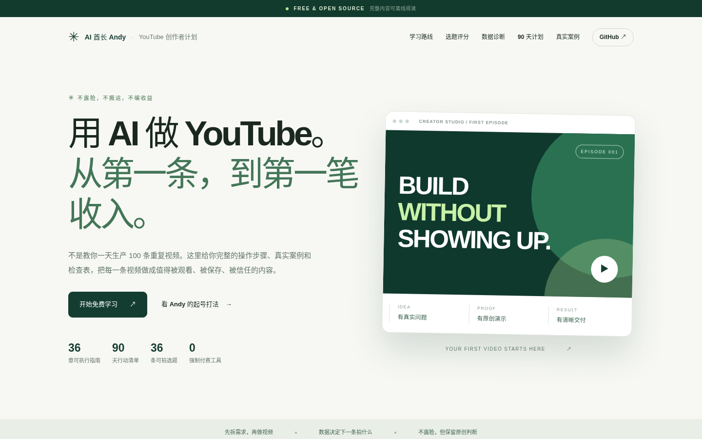

# YouTube 不露脸赚钱：从 0 到第一条原创视频，再到真实变现

> **36 章可执行指南 × 90 天带证据任务 × 5 个频道案例（含 Andy 待验证方案）× 36 个原创选题 × 数据诊断 + 收入情景测算**  
> By **AI 酋长 Andy**｜开源、可复现、无强制付费工具。重点是价值交付，而不是“AI 批量洗稿”。



[在线站点（仓库发布后启用 Pages）](https://aipmandy.github.io/HowToMakeMoneyOnYouTube/) · [作者 GitHub](https://github.com/AIPMAndy) · [官网](https://metaver.vip/) · [知识库](https://kb.metaver.vip/)

> **发布状态**：项目源码已提交至 GitHub，Pages 部署状态以 Actions 为准；上面的 Pages 地址是预期部署地址，不代表已部署完成。若在其他账号 fork，修改 `SITE_URL`、`docs/index.html` 中的 canonical 和 OG URL 后重新构建。

## 你能在这里做成什么

- 从个人资源和用户需求选择一个可长期经营的频道方向，不需要真人出镜。
- 从搜索、评论和竞品中找到 50 条问题，通过 5 维评分挑出首发选题。
- 用自己的屏幕录制、脚本、旁白和素材制作一条原创 6–10 分钟视频，再拆解 Shorts。
- 上传前检查封面、版权、AI 披露、说明、字幕与资源入口。
- 用 24 小时 / 72 小时 / 7 天数据判断下条拍什么，不编造“算法秘籍”。
- 走向 **开源工具、服务、赞助、联盟、平台广告** 等不同商业模式；不承诺任何收益。

## ⭐ 立即开始：60 分钟最小试验

| 时间 | 执行 | 产出 |
| --- | --- | --- |
| 0–10 分钟 | 选你能完整演示的 AI 工具任务 | 1 句话的观众结果 |
| 10–20 分钟 | 将结果压缩成 30–60 秒脚本 | 3–5 句话、明确首句 |
| 20–35 分钟 | Mac 录屏真实操作，删掉个人信息 | 原创画面 |
| 35–45 分钟 | 剪掉停顿，录旁白或配音并校对 | 竖版 Short |
| 45–60 分钟 | 检查素材、标题、字幕并发布 | 视频链接、首轮数据记录 |

**如果要更具体**：从 `workshops/01-first-video-FreeRedact.md` 开始，配合 `templates/VIDEO_BRIEF.md` 和 `templates/PUBLISH_CHECKLIST.md`。这是真正能照着做的第 1 条视频。

## 内容架构

```text
HowToMakeMoneyOnYouTube/
├── README.md / README_EN.md
├── data/                    # 内容的唯一事实源（JSON）
│   ├── guides.json          # 36 章指南
│   ├── ideas.json           # Andy 36 题，含素材与原始证据要求
│   ├── cases.json           # 真实频道案例及证据边界
│   ├── sources.json         # 原始资料链接与核查日期
│   └── plan90.json          # 90 天操作清单
├── docs/                    # 可在 GitHub Pages 上访问的静态网站
│   ├── index.html
│   ├── guides/*/index.html  # 每章独立 URL，适合搜索检索
│   ├── assets/              # 本地交互与网站样式
│   └── sitemap.xml / robots.txt / llms.txt
├── workshops/               # 手把手操作示例
├── templates/               # 脚本、事实核验、数据、发布检查表
├── prompts/                 # 不替代事实验证的 AI 指令
├── examples/                # 已填写的演示示例（不冒充真实数据）
├── cases/                   # 真实案例拆解
├── audit/                   # 竞品、对抗审核、发布复验
├── strategy/                # Andy 12 周增长与可归因收入打法
├── scripts/                 # 构建、评分、创建单集、视频工具、数据诊断、发布门禁
├── tests/                   # 零第三方依赖内容回归测试
└── .github/workflows/       # CI + Pages 部署
```

## 内容路线（36 章）

| 阶段 | 内容 | 交付 |
| --- | --- | --- |
| 起号与定位 | 从用户需求、竞品、50 条真实问题选题 | 频道定位、候选库 |
| 原创生产 | 事实查证、脚本、录屏、剪辑、封面 | 原创长视频与 Shorts |
| 传播与复盘 | 发布、跨平台分发、CTR/留存复盘 | 内容包、数据表 |
| 商业闭环 | 服务映射、赞助/联盟、YPP 资格 | 可验证的收入实验 |
| 规模化 | 90 天实验、Red Team 复审 | 运营决策记录 |

完整细节见 `data/guides.json`，或打开 `docs/index.html` 互动阅读。

## 专门针对 AI 酋长 Andy 的频道策略

**核心定位**：不露脸的 AI 实战课堂：普通人如何使用真实 AI 工具解决工作与收入问题。**建议首 90 天：一个中文频道**，优先服务繁体中文与简体中文都能理解的海外华语市场（台湾、香港、马来西亚、新加坡等）；英文版另行通过字幕和配音验证，不同时养多个新频道。

| 栏目 | 开头例子 | 原创证据 | 关联入口 |
| --- | --- | --- | --- |
| 免费 AI 工具 | “不用额外买会员，这事免费能做” | FreePhoto / FreeCover / FreeRedact 实测 | GitHub 免费工具 |
| AI 求职与副业 | “简历别先交给 AI 瞎改” | 可公开的脱敏方法与原始演示 | 400 元单次咨询、4500 元陪跑（价格变动需核对） |
| 企业 AI 实战 | “一个企业 AI 项目为什么卡在知识交付？” | 可公开的 DNASkill、公开项目演示 | 企业合作 |
| AI 创作者 | “开源工具怎样换来真实的用户信任？” | HowToBeAnAICreator 及自身运营经验 | 400 元/年 AI 醒觉社、其他服务 |

**已有平台反馈不是 YouTube 实测数据。** Threads 上验证过的“冷知识”是选题假设来源；是否能在 YouTube 获得有效观看和线索，需要独立验证。

**商业顺序**：每期免费交付实用价值 → 免费 GitHub/工具 → 有明确需求的观众自愿选择服务 → 有足够受众后再测试赞助或 YPP 广告。绝不把 `观看量 × 自拟 RPM` 当成收入事实。

## 90 天目标（计划，不是成绩）

- **前 30 天**：1 个频道、1 个清晰赛道、4 条左右长视频、8–12 条 Shorts、50 个选题、每周一次复盘。
- **第 31–60 天**：找出观看、留存和有效行动同时较好的主题，做成 3–5 期系列。
- **第 61–90 天**：稳定生产，在视频中让观众自然找到开源内容或服务入口，记录真实询盘和收入。
- **判断继续与否**：不是 90 天有没有“爆”，而是有没有出现可重复的用户需求、内容反馈和商业行动。

## YouTube 规则（核对时间：2026-11-05）

| 项目 | 目前官方口径 | 原始来源 |
| --- | --- | --- |
| 扩展 YPP | 符合地区/其他资格前提下：500 订阅；近 90 天 3 次公开上传；近 365 天 3000 小时**合格**长视频观看，或近 90 天 300 万**合格** Shorts 观看 | [YouTube](https://support.google.com/youtube/answer/94522?hl=en) |
| 广告与 Premium（2026） | 1000 订阅＋近 365 天 4000 合格长视频小时，或近 90 天 1000 万合格 Shorts 观看 | [YouTube](https://support.google.com/youtube/answer/94522?hl=en) |
| **官方已公告 2027-02-01 将调整** | 对新申请广告及 Premium 的频道，上述阈值更改为 1000 订阅＋8000 合格长视频小时，或 2000 万合格 Shorts 观看；扩展 YPP 的较早门槛不变 | [YouTube 新政](https://support.google.com/youtube/answer/12843009?hl=en) |
| 内容质量 | 原创、有实际价值；纯搬运、重复量产、模板化内容可能不符合 YPP | [YouTube](https://support.google.com/youtube/answer/1311392?hl=en) |
| AI 披露 | 写实合成/显著篡改并可能让观众误认真实的人物、场景或事件，应按 Studio AI use 规则披露；脚本辅助与普通美化不等同必须披露的情形 | [YouTube](https://support.google.com/youtube/answer/14328491?hl=en) |
| 标题/封面 A/B | 符合资格的长视频可测最多三组，工具按观看时长判断胜出版本 | [YouTube](https://support.google.com/youtube/answer/16391400?hl=en) |

国家地区资格、账户状态、有效观看定义与最终审核以 **YouTube Studio → Earn** 为准。上面区分了现行与未来生效日期。

## 真实案例（不要编造 RPM）

- [MagnatesMedia](https://www.youtube.com/@MagnatesMedia)：商业故事纪录片；创始人在[自有官网](https://magnatesmedia.com/)披露规模与收入，为**自述数据、未经独立审计**。
- [PolyMatter](https://polymatter.yt/)：由原创动画、图表与解说构成的知识视频；官网公开描述了封面设计与 Nebula 分发方式。
- [Wendover Productions](https://www.wendoverproductions.com/)：将经济、交通和地理问题做成解释性视频。
- [How Money Works](https://www.youtube.com/watch?v=4X2droxtGbQ)：公开视频描述可核对赞助、商城与 newsletter 等多元入口。
- **Andy 计划实验**：公开 GitHub 项目真实存在，但尚无本教程新 YouTube 频道的收入/观看实测，不把计划称为成功案例。

详细来源日期与证据边界见 `data/cases.json`、`data/sources.json`、`cases/CASEBOOK.md`。

## V2：真正能执行的升级（2026-11-05）

本次不是仅改文案，而是补了四条完整的链路：

1. **研究→选题→拍摄**：36 章详细到示例/最常见失败/明确验收，36 条按 Andy 现有工具与服务设计的可拍选题；另有 [12 周选题日历](strategy/ANDY_12_WEEK_GROWTH.md)、[30 天按天执行示范](workshops/06-first-30-days-sprint.md) 和 [FreePhoto 从头到尾分镜](workshops/07-full-freephoto-production.md)。
2. **发布→数据诊断→改进**：可在网站手填展示、CTR、留存、资源点击、有效询盘；另可用 `scripts/analyze_metrics.py` 对本地 CSV 做分格式、分来源、分观察窗口分析；未知数据不补零，不使用万能 CTR 阈值。
3. **免费资源→客户→实收**：浏览器收入情景测算器＋[Andy 单位经济模型](strategy/YOUTUBE_TO_REVENUE.md)、询盘来源台账、收款台账；默认不把旧客户的 B 端复购算进新频道获客。
4. **红队→修复→复验**：`scripts/check_episode.py` 做发布前文件存在性与人工审批门禁；[V2 问题修复台账](audit/V2_CHALLENGE_LOG.md) 列出具体失败情形和复验说明。

**边界**：发布门禁只能检查引用文件和人工勾选，不能代替人核验事实/版权；本站收入模型只是输入假设的数学模拟，未取得真实 YouTube 账户数据，也未替用户发布视频。GitHub 仓库仍需本人创建。

## 立即开做：Andy 的前七天

- **Day 1**：填 [`templates/CHANNEL_ONEPAGE.md`](templates/CHANNEL_ONEPAGE.md)，只选择一个中文 AI 工具受众。
- **Day 2–3**：用官方搜索/评论采 20 个问题，扩成 50 选题，人工打分。
- **Day 4**：用 [`workshops/07-full-freephoto-production.md`](workshops/07-full-freephoto-production.md) 拍 FreePhoto 演示，文件大小与操作都必须来自自己实测。
- **Day 5–6**：剪一条独立完整的长视频，再分别重构 2 条竖屏 Shorts，按照 [`templates/VIDEO_SCORECARD.md`](templates/VIDEO_SCORECARD.md) 逐项审核。
- **Day 7**：自己发布到 YouTube，核对长视频说明中的免费项目链接；Shorts 用相关长视频或频道资料承接，不能假定 Shorts 文本外链可点击。

下一步看 [完整 12 周计划](strategy/ANDY_12_WEEK_GROWTH.md) 与 [商业链路](strategy/YOUTUBE_TO_REVENUE.md)。

## 本地运行

```bash
# 仅需要 Python 3.10+，无 Python 第三方依赖
python3 scripts/build.py
python3 -m http.server 8000 -d docs
# 浏览器访问 http://localhost:8000/

# 执行回归测试
python3 -m unittest discover -s tests -v
node --check docs/assets/app.js

# 创建一条新视频的文件夹，避免随手拍、随手忘
python3 scripts/new_episode.py --slug free-photo-demo --title "Mac 免费图片处理实测"

# 使用自己的录屏转成 1080p 横屏版本（需自行安装 FFmpeg）
python3 scripts/video_kit.py --input ./my-screen-recording.mp4 --output ./output/episode.mp4 --mode long

# 录入真实视频数据后再运行，不从 YouTube 抓取
python3 scripts/analyze_metrics.py templates/METRICS_INPUT.csv --output ./output/analytics.md

# 录制与所有人工核验完成后，按 manifest 门禁检查
python3 scripts/check_episode.py episodes/free-photo-demo/manifest.json
```

互动网站的搜索、任务勾选、选题评分、进度导入导出均在浏览器本地完成，无账户、无追踪脚本。**不会自动生成、上传或发布 YouTube 视频。** AI 调研和脚本生成必须有创作者事实核验，发布由人确认。

## 用于发布到 GitHub

请先在 GitHub 创建一个 Public 仓库 `HowToMakeMoneyOnYouTube`（本仓库文件不代替创建仓库操作）：

```bash
git init -b main
git add .
git commit -m "feat: complete faceless YouTube creator playbook"
git remote add origin https://github.com/AIPMAndy/HowToMakeMoneyOnYouTube.git
git push -u origin main
```

在 **Settings → Pages → Build and deployment → Source → GitHub Actions** 选择 Actions；`pages.yml` 将发布 `docs/`，CI 会先验证数据。详见 [PUBLISH.md](PUBLISH.md)。

## 开源许可、参与改进

- 代码：MIT（[LICENSE](LICENSE)）。原创教程文字、模板与图示：CC BY 4.0（[CONTENT_LICENSE.md](CONTENT_LICENSE.md)）。
- 第三方视频、截图、商标和原始页面不包含在本仓库版权许可内。
- 修复错误或提供案例：需要可访问原始来源、发布日期、核验日期、断言边界。参见 [CONTRIBUTING.md](CONTRIBUTING.md)。
- 对抗式审核详见 `audit/ADVERSARIAL_REVIEW.md`，竞品详见 `audit/COMPETITOR_BENCHMARK.md`。

**项目愿景**：让更多人类通过 AI 实现财富自由和精神自由。先帮助更多人获得实际成果，再考虑商业化。
